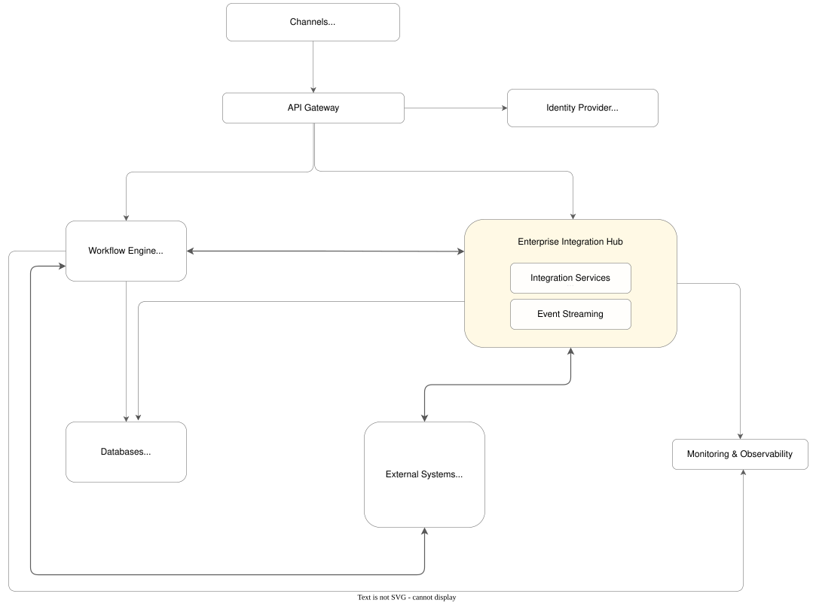
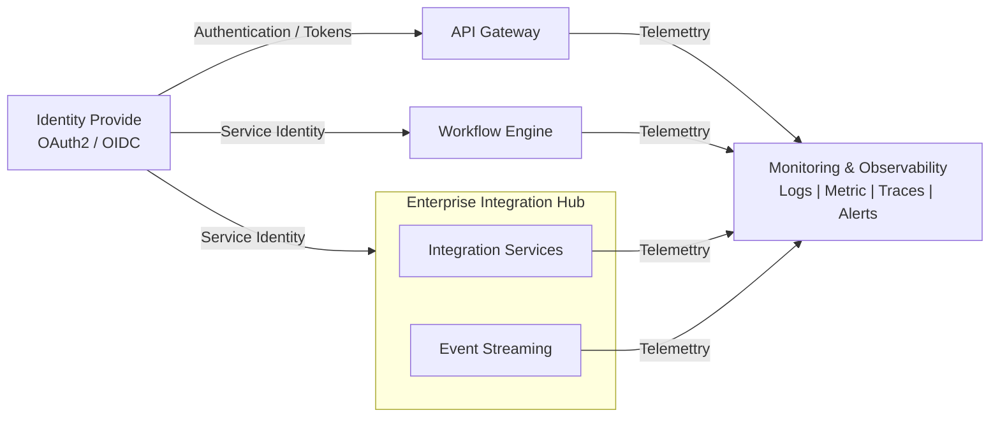

# Architecture Overview

The Enterprise Hub provides a centralized integration capability for connecting customer channels, business processes, enterprise applications and external services. 
This architecture combines API-based communication, workflow orchestration and event-driven integration to **ensure scalable and resilient business processes.**

The architecture separates responsibilities across distinct layers:
- **Access Layer** for API access and security
- **Process Layer** for workflow orchestration
- **Integration Layer** for system connectivity and event distribution
- **Operation Layer** for observability and monitoring

This separation improves maintainability, scalability and governance while reducing direct dependencies between systems. 

---
### Architecture Diagram

---

### Architecture Components

### API Gateway

The API Gateway acts as an entry point for all inbound requests.

Responsibilities:
- API routing
- Authentication and authorization
- Service discovery
- Rate limiting and throttling
- API monitoring

### Identitiy Provider

The Identity Provider provides centralized identity and access management.

Responsibilities:
- User authentication and authorization
- Issue and validate tokens
- Ensure secure service-to-service communication

### Workflow Engine 
The Wofklow Engine coordinates long-running business processes that span multiple systems.

Responsibilities:
- Business process orchestration
- State management
- Process SLAs and error handling
- Integration to different systems

### Enterprise Integration Hub 
The Enterprise Integration Hub provides centralized and reusable integration capabilities between enterprise applications and external systems.

It contains two primary capabilities:

1. Integration Services
    Provides connection touchpoints and domain-oriented service capabilities

    Responsibilities:
    - System integration
    - Data transformation
    - Protocol mediation
    - Service abstraction

    Connected Systems: 
    - Core Banking, CRM , Payments, Loan Systems, Risk Management

2. Event Streaming
    Enables asynchronous communication between systems.

    Responsibilities:
    - Event publicaiton
    - Event consumption
    - Event replication
    
    Example events:
    - Customer Created, Order Completed, Payment Completed

### Databases
Database is the state machine for workflow execution and integration processing.
    
- **Supported Data Stores:**
  - Relational Databases (SQL)
  - Document Databases (NoSQL)

- **Responsibilities:**
    - Workflow state management
    - Transaction persistence
    - Configuration store
    - Audit trail retention

### External Systems
The Integration hub interacts with other banking platform that are system of record.

- **Examples:**
   - Core Banking Systems
   - CRM platforms
   - Fraud Detection Systems
   - Notification Services

### Monitoring & Observability
Provides operational visibility across the landscape.
- **Responsibilities:**
  - Centralized logging
  - Distributed tracing
  - Mertic collection and alerting
  - Dashboard reporting

---
### Cross-Cutting Concerns

Security and Observability span across components rather than belonging to a single business flow

### Security
- The Identity Provider established trusted identities across components and services.
- Approciate authentication and authorization policies are enforced at platform level

### Observability
- All major components publish telemetry to Monitoring & Observability capability.
The architecture should support telemetry informations such as,
Logs + Mertics + Traces + Alerts + CorrelationID

---

### Architecture Principles
1.  **Separation of concerns** — Key components like API management, workflow orchestration and integration hub have distinct responsibilities.
2. ** Decoupled services** — Applications communicate through standardized APIs and events rather than point-to-point dependencies.
3. ** Centralized integration capabilities** — Common integration concerns are provided as reusable platform capabilities.
4. **API-first integration** — Synchronous interactions are exposed through standardized and reusable APIs
5. **Event-driven where appropriate** — Asynchronous events are used when immediate responses are not required
6. **Independent scalability** — workflow, integration APIs and event-processing workloads can scale independently.
7. **Security by design** — Identity and access control are integrated into the platform architecture.
8. **Observable by design** — All critical integration flows provide logs, metrics, traces and operational alerts.

