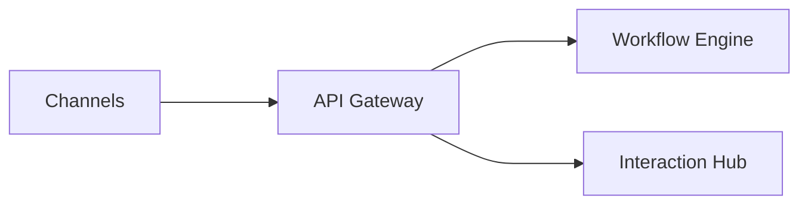
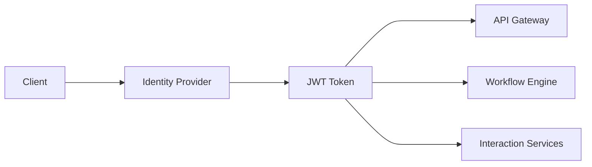
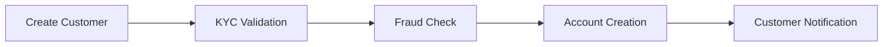
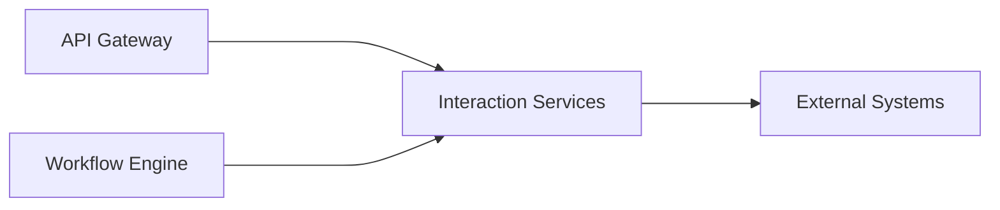
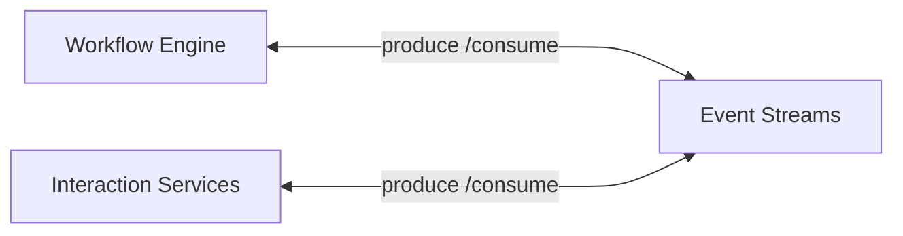
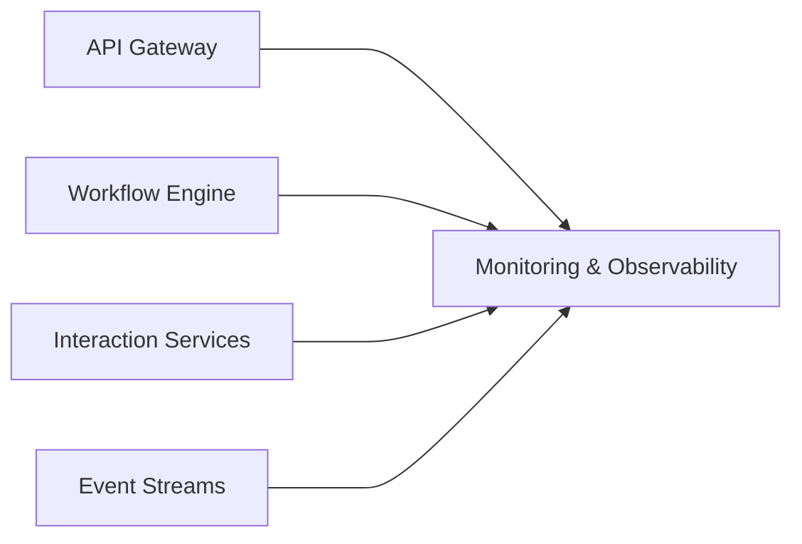

# Component Deep Dive

This section describes the responsibilities, interactions and architectural boundaries of the major components in the Enterprise Integration Hub.

---
### API Gateway

The API Gateway acts as an entry point for synchronous API traffic entering the platform.

#### Responsibilities
- API routing
- Authentication and authorization
- Service discovery
- Rate limiting and throttling
- API version management
- API monitoring

#### Key Interactions

#### Why It Exists
Without an API Gateway, each backend service must implement their own security, routing and traffic management independently, leading to redundant and inconsistent implementations.

---

### Identitiy Provider

The Identity Provider provides centralized identity and access management.

#### Responsibilities
- User authentication 
- Issue and validate tokens
- Service-to-service authentication
- Token lifecycle management
- OAuth2 and OIDC authentication

#### Key Interactions

#### Why It Exists
Banking applications require consistent identity management and authorizations across all channels and services.

--- 

### Workflow Engine 
The Wofklow Engine orchestrates long-running business processes that span multiple systems and services.

#### Responsibilities
- Process orchestration
- State management
- Long-running transactions
- Human task execution
- Business rule execution
- Compensation handling

#### Example Process

**Customer Onboarding**

#### Why It Exists
Embedding business processes inside integration services or other application creates tight coupling and disjoint implementations. A dedicated workflow layer provides centralized orchestration, process visibility and goverance.

---

### Enterprise Integration Hub 
The Enterprise Integration Hub provides centralized and reusable integration capabilities between enterprise applications and external systems.

It contains two primary capabilities:

### 1. Integration Services 
Provides connection touchpoints and domain-oriented service capabilities

    Responsibilities:
    - System integration
    - Data transformation
    - Protocol transaltion
    - Service abstraction
    - Error handling

    Connected Systems: 
    - Core Banking, CRM , Payments, Loan Systems, Risk Management

#### Key Interactions

#### Why It Exists
Integration Services standardizes how consumers interact with different services - support different protocols, message formats and integration styles.

#### 2. Event Streaming
    Enables asynchronous communication between producers and consumers.

    Responsibilities:
    - Event publishing
    - Event consumption
    - Event replication
    - Message delivery
    - Topic management
    - Customer isolation
    
    Example events:
    - Customer Created, Order Completed, Payment Completed
#### Key Interactions

#### Why It Exists
Direct service-to-service communication increases dependency between systems. Event streaming promotes decoupling of systems and share updates in real-time.

---

### Database Layer
Database Layer provides persistent storage for workflow execution,  operation data and auditing.
    
- **Supported Data Stores:**
  - Relational Databases (SQL)
       - Used for workflow state, transation history, configuraiton data, audit history 
  - Document Databases (NoSQL)
        - event metadata, high-volume operational data and analytical data
     
- **Responsibilities:**
    - Workflow state management
    - Transaction persistence
    - Configuration store
    - Audit trail retention

#### Why It Exists
reliable proccess execution requires durable storage and transaction information.

---

### External Systems
The Integration hub interacts with other banking platform that are system of record.

- **Examples:**
   - Core Banking Systems
   - CRM platforms
   - Fraud Detection Systems
   - Notification Services

#### Why It Exists
The Integration HUb does not replace business aplications. Its provides a standardized interface for communication between them.

---

### Monitoring & Observability
Provides operational visibility across all platform components.

-  **Responsibilities:**
  - Centralized logging
  - Distributed tracing
  - Metric collection and alerting
  - Dashboard reporting

- #### Key Interactions

- #### Why It Exists
A distributed platform with multiple compoents requires centralized visibility to trace, troubleshoot and monitor critical processes  and execution steps. 