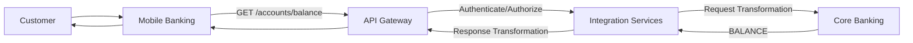

# Integration and Data Flow

The Enterprise Integration Hub supports multiple integration patterns based on business requirement. 
The architecture uses 
- synchronous API -> immediate response
- workflow orchestration -> business process execution
- event streaming -> asynchronous, decouple communication

### 1. Synchronous API Flow 

As an example, consider Account Balance flow. It requires immediate response and therefore uses synchronous API flow.


----

Client → API Gateway → Integration Service → Backend System
                    ← Response ←

Used when the consumer requires an immediate response.

### 2. Workflow Orchestration

Consider Loan Application process as an example, its involves multiple systems and business decisions and is a good candidate for workflow orchestration. 

```mermaid
flowchart LR


```

Request
   ↓
Workflow
   ├── Customer Service
   ├── Credit Service
   ├── Fraud Service
   └── Notification Service

Used when a business process requires coordination across multiple systems and steps.

These three patterns will form the foundation of the proposed Integration Hub architecture.


API Gateway
     │
Workflow ────────┐
     │           │
Integration ─────┼──→ Observability
     │           │     Logs
Events ──────────┤     Metrics
                 │     Traces
                 └───── Alerts


sequenceDiagram
    participant C as Client
    participant G as API Gateway
    participant I as Integration Service
    participant B as Core Banking

    C->>G: API Request
    G->>I: Route Request
    I->>B: Request
    B-->>I: Response
    I-->>G: Response
    G-->>C: API Response


sequenceDiagram
    participant C as Client
    participant G as API Gateway
    participant W as Workflow Engine
    participant I as Integration Services
    participant F as Fraud Service
    participant L as Loan Service
    participant N as Notification

    C->>G: Submit Loan Application
    G->>W: Start Workflow

    W->>I: Validate Customer
    I-->>W: Validation Result

    W->>I: Fraud Check
    I->>F: Check Fraud
    F-->>I: Fraud Result
    I-->>W: Result

    W->>I: Submit Loan
    I->>L: Loan Request
    L-->>I: Loan Decision
    I-->>W: Decision

    W->>I: Send Notification
    I->>N: Notification

   flowchart LR

    PAYMENT["Payment Service"]
    EVENT["Event Streaming<br/>Kafka"]
    FRAUD["Fraud Detection"]
    CRM["CRM"]
    NOTIFY["Notification Service"]
    ANALYTICS["Analytics"]

    PAYMENT -->|"PaymentCompleted"| EVENT

    EVENT --> FRAUD
    EVENT --> CRM
    EVENT --> NOTIFY
    EVENT --> ANALYTICS

--- 

Asynchronous Event

Producer → Event Stream → Consumer(s)

Used for decoupled, event-driven communication.