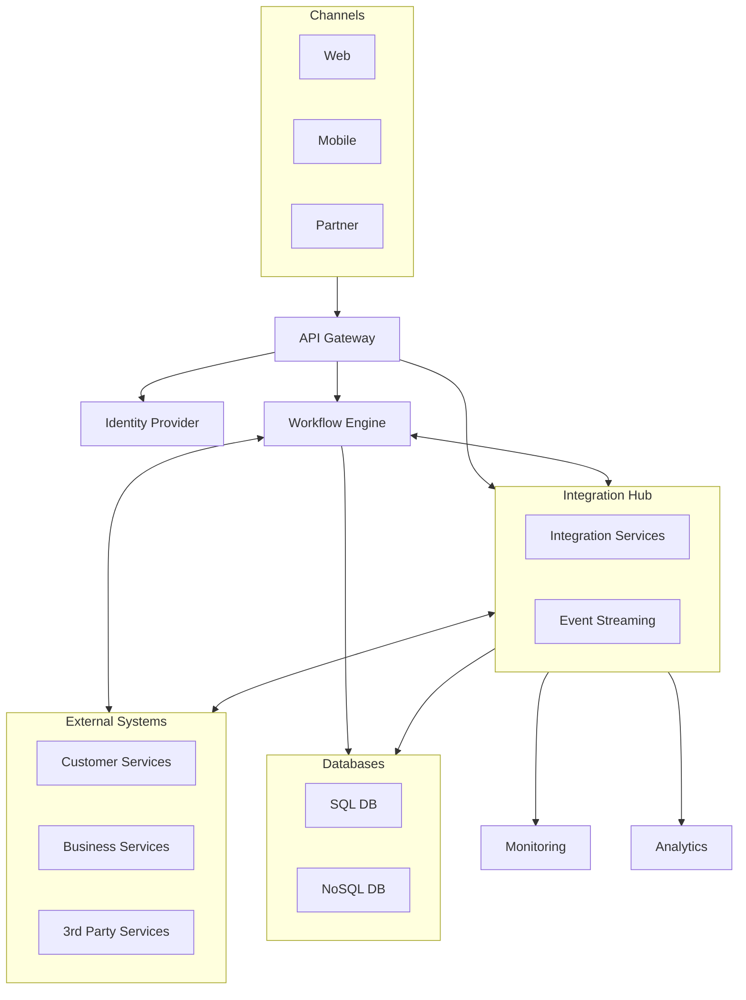

A banking Integration Hub lets you naturally discuss:
---
Payments
Loan origination
Customer onboarding
Fraud detection
Notifications
Compliance
Audit
Event-driven processing
---
Systems include:
Internet Banking
Mobile Banking
CRM (Pega / Salesforce)
Loan Origination
Core Banking
Payment Gateway
Fraud Service
Notification Service
Document Service
Data Warehouse
---
The Integration Hub sits in the middle using:

API Gateway
Workflow Engine
Event Streaming (Kafka)
Integration Services
Identity Provider
Observability

Non-Functional Requirements

Architecture Overview
mermaid 

